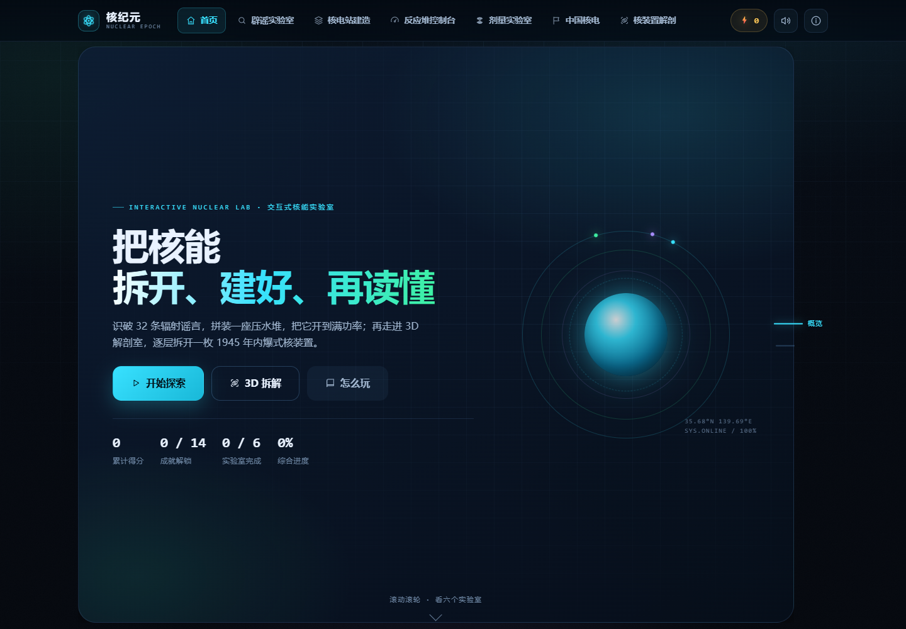
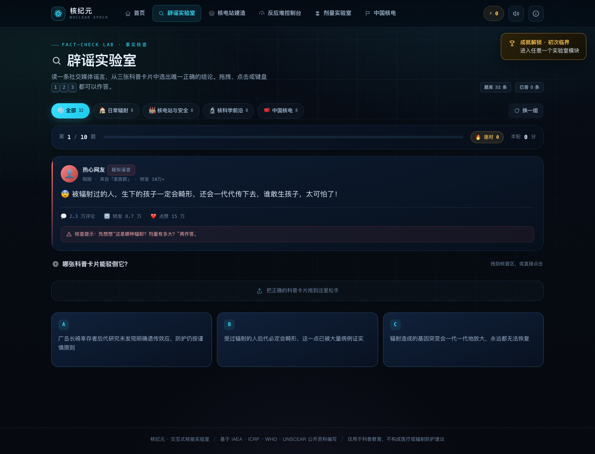
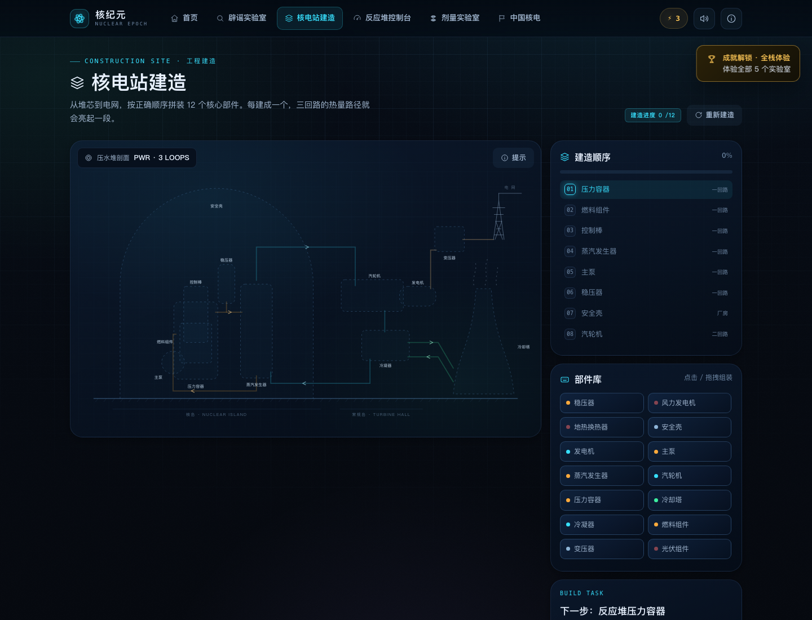
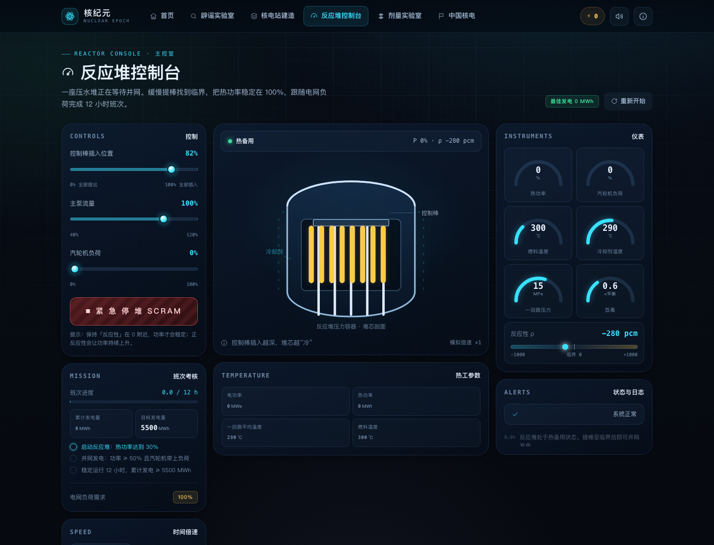
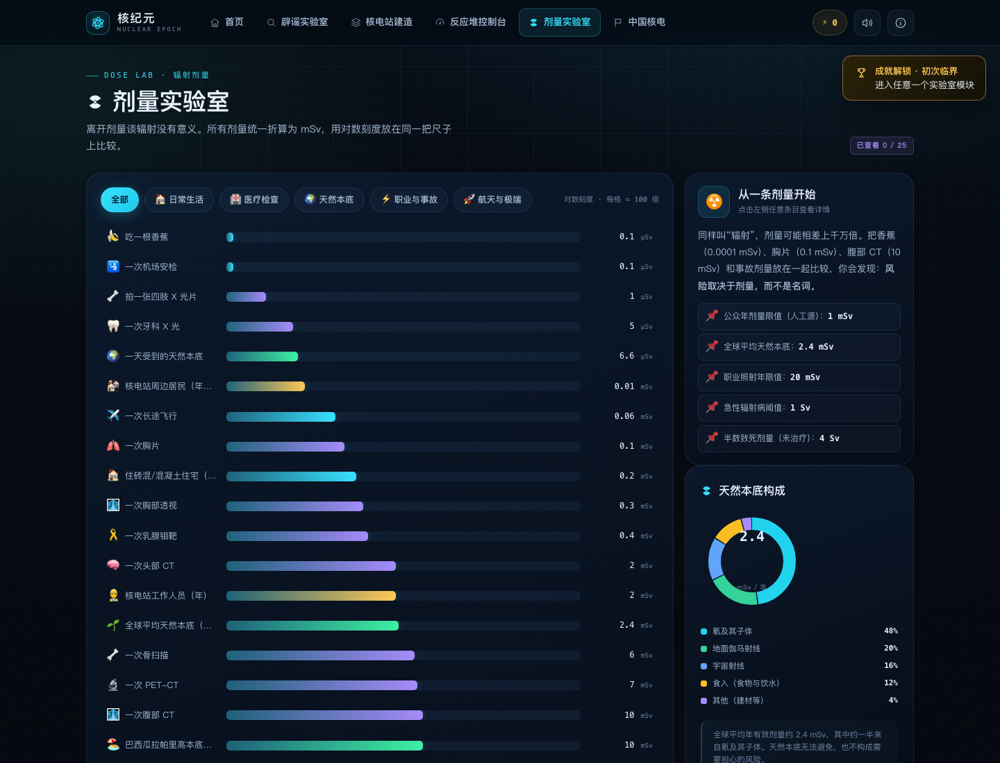
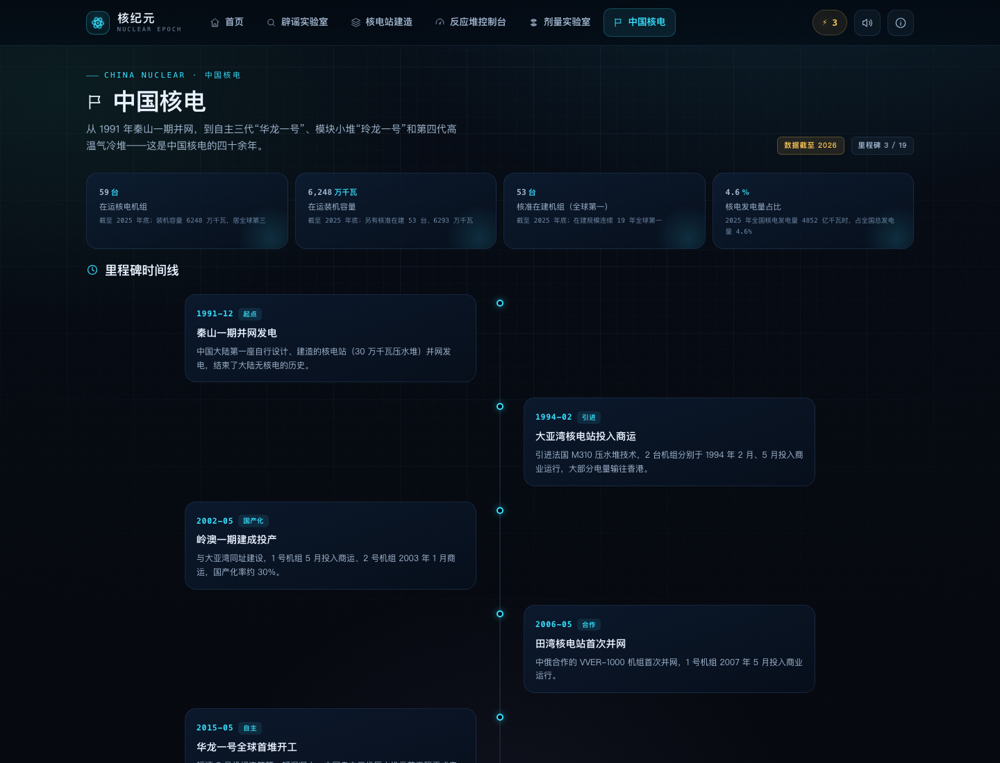
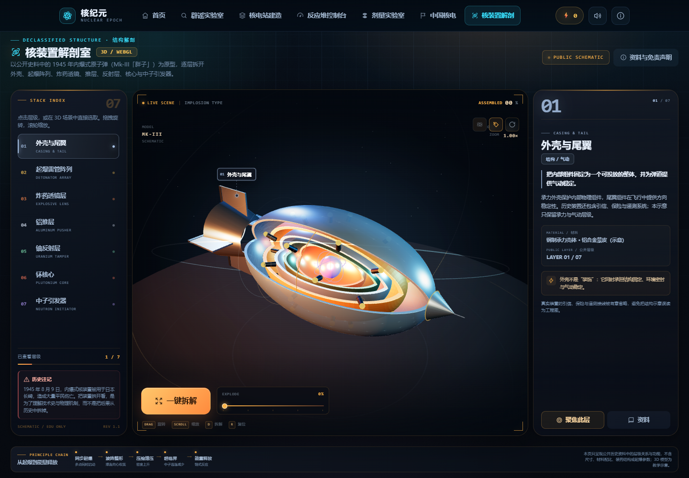
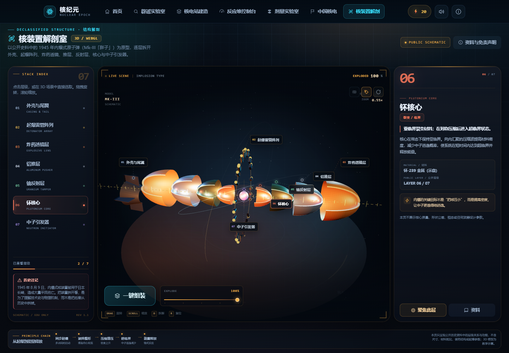
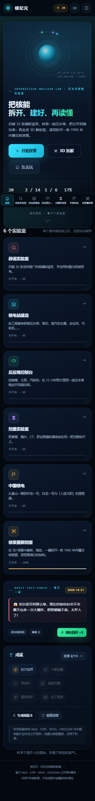

<div align="center">

# ⚛️ 核纪元 · Nuclear Epoch

**一座可以亲手拆开、建好、再启动的交互式核能实验室**

识破 32 条辐射谣言 · 拼装 12 个压水堆部件 · 把反应堆开到满功率 · 用对数标尺看懂剂量 · 读懂中国核电四十余年 · 在 3D 中拆开一枚历史核装置

[](#)
[](#)
[](#)
[](#)
[](#)
[](#)
[](#)
[](#)

</div>

---

## 📸 界面预览

| 驾驶舱首页 | 辟谣实验室 |
| :---: | :---: |
|  |  |

| 核电站建造 | 反应堆控制台 |
| :---: | :---: |
|  |  |

| 剂量实验室 | 中国核电 |
| :---: | :---: |
|  |  |

| 核装置解剖 · 整体剖面 | 核装置解剖 · 一键拆解 |
| :---: | :---: |
|  |  |

<div align="center">

</div>

---

## 📖 项目简介

**核纪元**是一款零构建、打开即玩的交互式核能科普网页应用。它不满足于“读一读知识”，而是把核能领域最容易误解、也最值得亲手体验的部分，拆成六个可以**操作**的实验室：

- 用 **32 条社交媒体谣言**练习事实核查，每条都给出机制解释、关键数字与权威来源；
- 用 **12 个真实部件**按工程顺序拼出一座压水堆，并观察一 / 二 / 三回路如何传递热量；
- 用 **一个可运行的简化反应堆模型**验证“提棒—临界—功率自稳—停堆余热—氙毒”的完整因果链；
- 用 **对数刻度剂量图**把香蕉、胸片、CT、职业限值和事故剂量放在同一把尺子上；
- 用 **时间线、堆型卡与电站分布**串起中国核电从秦山一期到“华龙一号”“玲龙一号”“人造太阳”的路径；
- 用 **一个实时 3D 解剖台**逐层拆开 1945 年内爆式核装置，理解外壳、起爆阵列、透镜、推层、反射层、核心与引发器。

项目为纯静态站点，使用原生 HTML / CSS / JavaScript 编写：没有框架、没有构建步骤、没有后端；3D 使用仓库内置的 Three.js，不依赖 CDN，克隆后双击 `index.html` 即可运行。

> 本项目在早期开源小游戏《辟谣者联盟：核能纪元》的概念启发下**完全重写**：视觉系统、信息架构、交互方式、反应堆物理模型、全部代码与内容均为重新设计与实现。

---

## 🕹️ 六大实验室

| 模块 | 一句话玩法 | 核心知识点 |
| --- | --- | --- |
| 🔍 **辟谣实验室** | 读一条谣言，从 3 张卡片中拖出 / 点出唯一正确的科普结论 | 电离 vs 非电离辐射、剂量与风险、核电站三回路、核废料、核医学、核聚变 |
| 🏗️ **核电站建造** | 从堆芯到电网，按顺序拼装 12 个部件；顺序错误会“返工” | 压水堆结构、一 / 二 / 三回路、纵深防御、安全壳 |
| ⚡ **反应堆控制台** | 调节控制棒、主泵与汽轮机负荷，完成 12 小时并网发电班次 | 反应性、临界、负温度系数、氙-135 碘坑、停堆余热、保护系统 |
| 📊 **剂量实验室** | 在对数标尺上对比 25 种剂量，查看换算与等价值 | 天然本底、医疗剂量、剂量限值、Bq / Gy / Sv |
| 🇨🇳 **中国核电** | 滚动浏览 19 个里程碑、6 种代表性反应堆 / 装置与 15 个核电站条目 | 秦山、大亚湾、华龙一号、玲龙一号、高温气冷堆、EAST |
| 🧩 **核装置解剖室** | 在 3D 场景中旋转、缩放，一键把 7 层结构拆开再装回 | 内爆式结构、起爆阵列、炸药透镜、推层、反射层、临界与中子引发 |

### 🔍 辟谣实验室

- **32 条题库**，按「日常辐射 / 核电站与安全 / 核科学前沿 / 中国核电」四类各 8 条；难度分 1–3 级。
- 每题 1 条正确结论 + 2 条“听起来合理但明确错误”的干扰项，从题库中随机抽取，支持按分类练习。
- **三种作答方式**：鼠标 / 触屏拖拽到核查区、直接点击卡片、键盘 <kbd>1</kbd> <kbd>2</kbd> <kbd>3</kbd>。
- 答后立刻给出**事实核查卡**：正确结论、机制解释、关键数字（`fact`）、难度与 1–2 条权威来源；答错不卡关。
- 每轮 10 题，结算本轮得分、正确率与最高连对；答对 +10、连对额外加分、答错 −3。

### 🏗️ 核电站建造

- **自绘 SVG 压水堆剖面图**（无位图依赖）：安全壳、压力容器、堆芯燃料、控制棒、蒸汽发生器、主泵、稳压器、汽轮机、发电机、冷凝器、冷却塔、主变压器，共 12 个部件 + 5 张干扰卡。
- 建造顺序从堆芯到电网；顺序错误或点到干扰卡会扣分并提示，引导玩家理解“能量传递链”。
- 每建成一个回路，对应管道会亮起并出现流动动画；点击「回路状态」可单独查看一 / 二 / 三回路的温度、压力与放射性说明。
- 建成后结算并解锁「总工程师」成就。

### ⚡ 反应堆控制台

教学用简化压水堆模型（纯前端、可实时运行），保留关键因果链而不是堆砌公式：

| 物理量 | 模型中的行为 |
| --- | --- |
| **反应性 ρ** | 控制棒位置、燃料温度、冷却剂温度、氙毒共同决定；单位 pcm |
| **功率** | `dP/dt ∝ ρ`：ρ > 0 功率上升，ρ < 0 下降，ρ = 0 保持临界 |
| **负温度系数** | 功率升高 → 燃料 / 冷却剂温度升高 → 反应性下降，形成自稳 |
| **氙-135** | 碘-135 衰变生成氙，氙吸收中子；功率骤降后出现“碘坑”，需提棒补偿 |
| **热工** | 燃料→冷却剂传热、蒸汽发生器带走热量、主泵流量、余热排出系统 |
| **保护** | 超功率 / 超压自动停堆；停堆后仍有约 6% 余热，需持续冷却 |

玩家需要：缓慢提棒找到临界 → 升功率并带负荷 → 跟随电网负荷需求 → 应对氙毒 → 累计发电 ≥ 5500 MWh 且安全评分达标 → 完成 12 小时班次。提供 ×1 / ×2 / ×4 时间倍速、SCRAM 紧急停堆与停堆复位流程。

- **运行趋势**：切换热功率（%）、燃料温度（°C）、氙毒相对指数、电功率（MWe），每项使用独立单位与纵轴；可查看最近 2 小时或整个班次，停堆时刻以红色虚线标记。
- **数据回看**：移动指针、触屏轻点，或聚焦图表后按 ← / → / Home / End 查看采样；支持最近 10 条数据表和整班次 UTF-8 CSV 导出。记录来自模型状态，按模拟时间采样，切换模块自动清理。
- **参考线口径**：热功率 100% 与额定电功率是额定参考；800°C 是本教学模型的警戒值，氙指数 1 是相对参考值。模型对时间与氙变化做了压缩，不表示真实机组的预测曲线。

> 物理模型是**教学简化模型**，用于呈现方向正确的因果关系，不用于工程计算或真实操作训练。

### 📊 剂量实验室

- **25 条剂量数据**，覆盖日常生活、医疗检查、天然本底、职业与事故、航天与极端五类，统一折算为 mSv。
- **对数刻度**横向对比：每格 100 倍，从 0.1 µSv（一根香蕉）到 10 Sv（切尔诺贝利首批消防员的急性照射量级）。
- **量类区分**：癌症放疗的 60 Gy 是局部靶区吸收剂量，不能换算为全身有效剂量，页面单独说明、不混入 mSv 标尺。
- **年度参考线**：可分别显示公众额外照射 1 mSv/年、全球平均天然本底 2.4 mSv/年、职业照射 20 mSv/年。职业值按连续 5 年平均、单年不超过 50 mSv；公众限值不含天然本底、患者医疗与职业照射，不能将一次检查机械判为“超标”。
- **年度剂量估算器**：按次数估算长途飞行、胸片、头部 CT、胸部 CT、普通牙片的代表剂量，可选择计入天然本底；分别列出医疗、飞行、本底，校验无效输入并支持全部清零。代表值与 FDA、ACR/RSNA、CDC 等原始资料在页面中说明。仅为所选项目的量级估算，不作个人风险或限值判定。
- 点击任意条目查看量级说明、与香蕉 / 胸片 / 年本底的倍数关系；放疗 Gy 与有效剂量 Sv 的区别可展开查看。
- 天然本底构成环形图（UNSCEAR 口径，氡及子体约 48%）、Bq / Gy / Sv 单位小词典、µSv ↔ mSv ↔ Sv 换算器。

### 🇨🇳 中国核电

- **19 个里程碑**：1991 秦山一期并网 → 1994 大亚湾商运 → 2015 华龙一号首堆开工 → 2021 海外首堆投运 → 2023 石岛湾高温气冷堆商运 → 2025 EAST 1 亿 ℃ / 1066 秒……
- **6 种代表性反应堆 / 装置**：华龙一号 HPR1000、玲龙一号 ACP100、高温气冷堆 HTR-PM、示范快堆 CFR-600、国和一号 CAP1400、EAST 聚变装置。
- **15 个核电站条目**：秦山、大亚湾、岭澳、田湾、福清、红沿河、宁德、阳江、防城港、昌江、海阳、石岛湾、三门、漳州等。
- 时间线随滚动逐条记录“已浏览”，集齐后解锁「核电通」成就。

### 🧩 核装置解剖室

- **实时 3D 剖面**：以公开史料中的 1945 年内爆式装置为原型，使用 Three.js 构建外壳、起爆阵列、炸药透镜、铝推层、铀反射层、钚核心与中子引发器，共 7 层。
- **一键拆解 / 组装**：所有层级沿弹轴展开；外壳淡出、尾翼分离、32 个起爆点收束成环，核心与引发器留在轴心。可拖动拆解滑杆观察任意中间状态。
- **完整交互**：鼠标 / 触屏拖拽轨道旋转、滚轮 / 双指缩放；点击 3D 部件、左侧索引或屏幕标注都能选中，右侧面板同步显示功能、材料示意与公开层级。
- **HUD 辅助**：自动旋转、标注开关、视角复位、拆解进度、实时轨道角度 / 缩放倍率、动态部件标注与引导线；支持 <kbd>D</kbd> 拆解、<kbd>R</kbd> 复位、<kbd>L</kbd> 标注。
- **教学边界**：模型只呈现公开历史资料中的层级关系与功能，不包含尺寸、材料配比、装药结构、起爆时序等工程参数。页面内附历史注记、资料来源与免责声明。

> 3D 模型是**结构原理示意**，不是工程图纸，也不对应任何真实装置的制造数据。

---

## 🚀 快速开始

### 方式一：直接打开（推荐体验）

```bash
git clone https://github.com/Pig-7788/nuclearplsx.git nuclear-epoch
cd nuclear-epoch
open index.html        # macOS
# 或直接双击 index.html
```

无需安装任何依赖。音效需要一次用户交互后才会播放（浏览器策略）。

### 方式二：本地静态服务器

```bash
# Python 3
python3 -m http.server 8000

# 或 Node.js
npx serve .
```

访问 <http://localhost:8000>。

---

## 🧭 玩法与快捷键

| 操作 | 说明 |
| --- | --- |
| <kbd>1</kbd> <kbd>2</kbd> <kbd>3</kbd> | 辟谣模式中选择 A / B / C 卡片 |
| <kbd>Enter</kbd> | 辟谣模式：进入下一题 / 查看结算 |
| <kbd>Esc</kbd> | 关闭弹窗 |
| <kbd>?</kbd> | 打开帮助 / 快捷键 / 数据来源说明 |
| <kbd>D</kbd> / <kbd>R</kbd> / <kbd>L</kbd> | 3D 解剖室：拆解 / 复位视角 / 标注开关 |
| 方向键 / <kbd>+</kbd> <kbd>−</kbd> | 3D 解剖室：旋转视角 / 缩放 |
| 鼠标 / 触屏 | 所有卡片支持点击、拖拽；滑块支持拖动与键盘方向键；3D 场景支持拖拽 / 滚轮 / 双指 |

进度、得分、成就、每日一谣状态自动保存在 `localStorage`（键：`nuclear-epoch:v1`）；可在首页「重置进度」清空。

---

## 🏗️ 技术架构

### 零构建、离线优先

- **原生三件套**：HTML5 + CSS3 + 原生 JavaScript（经典脚本，无 ES Module，`file://` 直接可用）。
- **本地 3D 引擎**：仓库内置 Three.js r152 的 UMD 构建（`assets/vendor/three.min.js`），不使用 CDN；`file://` 直接打开也能加载 3D 场景。
- **无外部资源**：不加载任何字体、图片、CDN 或音频文件。背景网格、原子轨道、压水堆剖面、堆芯、仪表盘、核装置几何全部用 CSS / SVG / WebGL 程序化绘制；音效由 Web Audio 实时合成。
- **离线可用**：断网状态下功能完全正常。

### 模块化设计

```
index.html                      # 页面骨架：头部导航 / 主视图 / 弹层 / Toast 容器
README.md
docs/
└── screenshots/                # 界面截图（README 预览用）
assets/
├── css/
│   ├── theme.css               # 设计令牌、重置、排版、工具类、动效
│   ├── layout.css              # 顶栏 / 导航 / 主区域 / 页脚 / 通用版式
│   ├── components.css          # 按钮、面板、弹窗、Toast、芯片、拖拽、进度…
│   └── modes/                  # 每个实验室一份样式
│       ├── home.css  rumor.css  city.css
│       ├── console.css  dose.css  china.css
│       ├── device.css         # 3D 解剖室 HUD / 面板 / 标注 / 响应式
│       └── fullpage.css         # 首页翻页与部分实验室一屏布局
├── vendor/
│   └── three.min.js            # 本地 Three.js r152（离线 3D）
└── js/
    ├── task-manager.js         # ★ 模块任务管理器：注册 / 排序 / 挂载 / 卸载 / 进度
    ├── core.js                 # 路由、存档、成就、音效、UI、分享卡
    ├── console-model.js        # 反应堆物理模型（纯逻辑，无 DOM）
    ├── console-trends.js       # 趋势采样 / SVG / CSV，独立于物理模型
    ├── fullpage.js             # 一屏外壳 / 首页翻页 / 中国核电循环滚动
    ├── svg.js                  # 压水堆剖面 / 堆芯 SVG 生成
    ├── data/
    │   ├── rumors.js           # 32 条辟谣题库
    │   ├── doses.js            # 25 条剂量 + 参考线 + 本底构成 + 单位
    │   ├── china.js            # 中国核电数据
    │   ├── reactor.js          # 12 个部件 + 三回路 + 控制台任务参数
    │   └── device.js           # 核装置 7 层结构 / 原理链 / 历史注记
    └── modes/
        ├── home.js  rumor.js  city.js
        ├── console.js  dose.js  china.js
        └── device.js           # Three.js 场景 / 拆解动效 / 拾取 / 标注
```

### Task Manager：模块统一调度

`task-manager.js` 是应用的模块总线（`NEG.tasks`），负责：

- **注册**：`NEG.registerMode({ id, order, title, nav, icon, blurb, accent, progress, isComplete, render })`；
- **生命周期**：挂载前自动卸载上一模块，执行 `cleanup`（清理计时器 / 事件监听 / rAF），渲染异常时降级为友好提示，不拖垮整页；
- **进度与状态**：模块声明自己的 `progress(state)` 与 `isComplete(state)`，首页磁贴、导航、综合进度、成就系统统一读取；
- **排序**：按 `order` 生成导航与首页网格。

新增一个实验室只需：写一个模块文件 → 在 `index.html` 引入 → 注册进 Task Manager。样式按 `assets/css/modes/<id>.css` 独立维护，互不污染。

### 其他技术点

| 技术 | 用途 |
| --- | --- |
| **Three.js / WebGL** | 程序化生成核装置 7 层几何、PBR 金属材质、程序化环境贴图、粒子与扫描环；30+ 动效对象逐帧插值 |
| **自定义轨道控制** | 指针拖拽 / 双指缩放 / 滚轮 / 键盘，带阻尼与自动侧视运镜，不依赖 OrbitControls |
| **3D 拾取与标注** | Raycaster 部件拾取、屏幕空间标注追踪、SVG 引导线、剖切端面与拆解状态管理 |
| **SVG 自绘** | 压水堆剖面、堆芯、剂量环图、仪表弧、图标系统，矢量清晰、可换主题 |
| **Web Audio API** | 点击、成功、失败、落棒、完成等音效实时合成，无音频文件 |
| **Canvas** | 一键生成 1200×630「战绩卡」，可下载 PNG 分享 |
| **Pointer Events** | 鼠标 / 触屏 / 手写笔统一的拖拽实现（带拖影、落区高亮） |
| **localStorage** | 得分、成就、各模块进度、每日一谣状态持久化 |
| **IntersectionObserver** | 中国核电时间线逐条记录浏览进度 |
| **CSS 变量 + clamp + Grid** | 统一主题、流式字号、响应式三档断点 |
| **prefers-reduced-motion** | 尊重系统“减少动态效果”设置，关闭动画 |
| **无障碍** | 语义化按钮 / 导航、焦点样式、弹窗焦点陷阱、<kbd>数字键</kbd>作答、`aria-label` |

---

## 🔬 教学模型与数据说明

### 反应堆模型

控制台采用**点堆简化 + 集总热工**模型，每帧积分：

- 反应性：`ρ = ρ_棒 + α_f (T_f − 600) + α_m (T_c − 326) + ρ_氙 + ρ_中子毒物`
- 功率：`dP/dt = ρ / K`（`ρ` 单位 pcm，`K = 25 pcm/(%/s)`）
- 热工：燃料与冷却剂两节点能量平衡，蒸汽发生器按负荷与温度带走热量，低功率 / 停堆时由余热排出系统维持约 285 ℃ 热停状态
- 氙毒：碘-135 / 氙-135 简化微分方程（时间轴做了教学压缩，使“碘坑”可在班次内观察到）

该模型用于展示**方向正确的因果链**（负反馈自稳、停堆余热、氙毒补偿、负荷跟随），不代表真实机组参数，**不可用于工程计算或操作训练**。

### 数据来源

科普内容与数据整理自以下公开资料：

- **IAEA**（国际原子能机构）公开技术文件与 PRIS 数据库
- **ICRP**（国际辐射防护委员会）第 103 号出版物等
- **WHO**（世界卫生组织）电磁场与辐射健康实况报道
- **UNSCEAR**（联合国原子辐射效应科学委员会）天然本底报告
- **国家核安全局 / 国家原子能机构 / 国家能源局**
- **中国核能行业协会**《中国核能发展报告》《中国核电发展报告》
- 中核集团、中广核等公开资料

剂量数值为公开资料中的**典型量级**，不同来源、不同个体、不同场景可能存在差异；中国核电统计数字截至 2025 年底，大事记更新至 2026 年 8 月（数据集中 `updated` 与 `updatedNote` 字段）。

---

## ✏️ 自定义与扩展

### 添加一条谣言

在 `assets/js/data/rumors.js` 的数组中追加：

```js
{
  id: 33,
  category: "daily",              // daily | safety | frontier | china
  difficulty: 2,                  // 1–3
  topic: "微波炉",                 // 2–8 字短标签
  text: "社交媒体上的谣言原文……",
  truth: "唯一正确的科普结论。",
  distractors: ["似是而非的错误说法 1", "似是而非的错误说法 2"],
  explain: "机制 + 关键数字 + 常见误区的完整解释。",
  fact: { label: "关键数字", value: "约 0.1 mSv" },
  sources: [{ name: "ICRP 第103号出版物", url: "https://www.icrp.org/" }]
}
```

游戏会自动纳入随机抽题与通关判定。

### 添加一个实验室模块

1. 在 `assets/css/modes/` 新建 `<id>.css`，在 `index.html` 引入；
2. 新建 `assets/js/modes/<id>.js`，调用：

```js
NEG.registerMode({
  id: "mylab",
  order: 6,
  title: "我的实验室",
  nav: "我的实验室",
  icon: "sparkles",              // 内置图标名
  accent: "#a78bfa",
  blurb: "一句话介绍",
  progress(s) { return 0.5; },
  isComplete(s) { return false; },
  render(root, ctx) {
    // ctx: { go, store, data, ui, audio, util, icon, achievements }
    root.innerHTML = "<h2>Hello</h2>";
    return () => { /* cleanup */ };
  }
});
```

3. 在 `index.html` 底部引入脚本即可；导航、首页磁贴、成就统计会自动接入。

### 调整物理参数

`assets/js/console-model.js` 顶部 `K` 对象集中了控制棒价值、温度系数、热容、传热系数、氙衰变常数等；`assets/js/data/reactor.js` 中的 `console` 段配置额定功率、任务时长与事件。

### 更换主题

`assets/css/theme.css` 的 `:root` 是唯一的设计令牌入口：底色、强调色、三回路配色、圆角、阴影、动效曲线都在这里。

---

## 🌐 部署到 GitHub Pages

本项目是纯静态站点，零构建：

1. 将仓库根目录的 `index.html`、`assets/`（及可选的 `docs/`）推送到 GitHub；
2. 仓库 **Settings → Pages**；
3. **Build and deployment → Source** 选择 **Deploy from a branch**；
4. **Branch** 选择 `main`，目录选择 **`/ (root)`**，保存；
5. 等待 1–2 分钟，访问 `https://<username>.github.io/<repo>/`。

> `index.html` 必须位于部署目录根层级，`assets/` 与其同级。项目不使用任何绝对路径或构建产物。启用后访问 <https://pig-7788.github.io/nuclearplsx/>。

---

## 💻 浏览器兼容性

| 浏览器 | 支持情况 |
| --- | --- |
| Chrome / Edge / Safari / Firefox 近两年版本 | ✅ 完整支持 |
| 移动端浏览器（iOS Safari / Android Chrome） | ✅ 响应式布局 + 触屏拖拽 + 触感反馈 |
| 旧版 IE / 不支持 Pointer Events 的浏览器 | ❌ 不支持 |
| 无音效环境 / 静音 | ✅ 一键静音，状态持久化 |
| 系统开启“减少动态效果” | ✅ 自动关闭动画 |

> 音效依赖 Web Audio API，浏览器要求先发生一次用户交互才能播放，因此首次点击后才会出声。

---

## 🧪 验收记录（开发自测）

第二批功能提供可重跑的测试（Node.js 20+；仅测试需要 npm，网页运行无需安装依赖）：

```bash
npm test                       # 采样、时序、CSV、内存上限等纯逻辑回归
npm ci                         # 安装浏览器测试开发依赖
npm run test:browser            # 本地 Chrome：真实页面、加速模拟时钟、桌面及窄屏
# 其他系统可通过 CHROME_BIN 指定已安装的 Chrome / Chromium 路径
```

浏览器测试覆盖四种曲线与键盘回看、停堆和完整班次、CSV、页面卸载、年度估算分项、无效输入、清零、参考线开关、Gy/Sv 展开说明、768/390/320px 无横向溢出、七个路由、3D 拆解 / 组装 / 键盘快捷键、`file://` 启动及趋势脚本加载失败后的重试恢复。`SCREENSHOT_DIR` 可指定测试截图目录。

使用 Playwright + 本地 Chrome 对以下路径做过自动化回归（0 个 JS 错误）：

- 首页渲染、6 个模块磁贴、每日一谣揭晓、成就墙、分享卡生成（Canvas 1200×630）；
- 辟谣：点击 / 拖拽 / 键盘作答、结果面板、来源显示、下一题、分类筛选、结算；
- 建造：12 个部件按序拼装、干扰卡扣分、回路贯通动画、回路说明弹窗、完成结算；
- 控制台：提棒启动、功率跟随、SCRAM / 停堆复位、×4 倍速完整 12 小时班次（成功路径：5567 MWh / 安全 100 / 得分 240 / 解锁「金牌运行员」「稳如磐石」）；
- 剂量：25 条数据排序与对数条、详情、换算器、分类筛选、环形图；
- 中国核电：19 条时间线滚动记录、数据卡、堆型与基地；
- 核装置解剖：WebGL 场景建立、7 层索引、部件拾取、一键拆解 / 组装、滑杆中间态、资料弹窗、<kbd>D</kbd> / <kbd>R</kbd> / <kbd>L</kbd> 快捷键；
- 存档刷新后保留；`file://` 直接打开可运行；桌面 1440、平板 1024、移动端 390 / 320 无横向溢出。

---

## ⚠️ 已知简化与后续计划

- [ ] 反应堆模型为教学简化，未包含硼浓度、多群中子动力学、燃料燃耗与衰变链细节；
- [ ] 剂量数据为典型量级，尚未按国家 / 年份细分；
- [ ] 触屏拖拽在部分旧版移动浏览器上体验一般，已提供点击作为等价操作；
- [ ] 核装置 3D 模型为教学化层级示意，不对应真实工程结构，也不包含尺寸、材料配比与起爆参数；
- [ ] WebGL 不可用时自动降级为文字索引，不阻断其它实验室；
- [ ] 可增加 PWA（离线缓存 / 安装到桌面）；
- [ ] 可增加「知识卡导出」「班级排行榜」「无障碍语音讲解」；
- [ ] 可增加更多四代堆、核能供暖、核医学等专题实验。

---

## 📚 引用与致谢

- 概念启发：本仓库的早期版本《辟谣者联盟：核能纪元》（保留在 git 提交历史中）。本项目在其「打假 + 建造」创意基础上**完全重写**了视觉、交互、物理模型与全部内容。
- 科普事实与数据来自 IAEA、ICRP、WHO、UNSCEAR、国家核安全局、国家能源局、中国核能行业协会等公开资料；核装置结构层级参考 Smithsonian National Air and Space Museum、U.S. Department of Energy 与 National Museum of Nuclear Science & History 的公开条目。如发现事实错误，欢迎提交 Issue 指正。

---

## ⚠️ 免责声明

本项目为**科普教育作品**，不构成医疗建议、专业辐射防护指导或工程设计依据。剂量数值为典型量级，个体与实际场景可能存在差异；中国核电数据以文中标注年份为准；核装置 3D 模型只呈现公开历史资料中的层级关系与功能，不包含任何工程参数，也不得被用于制造目的。实际辐射剂量、健康风险与安全标准请以权威机构发布的最新文件为准。

<div align="center">

**科学不是吓人的理由，而是不害怕的底气。**

</div>
